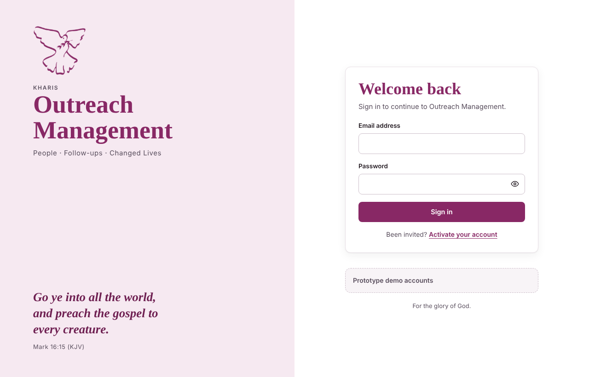
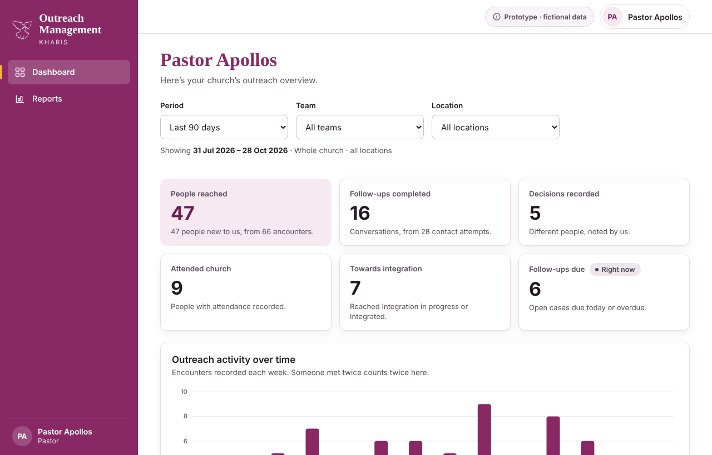
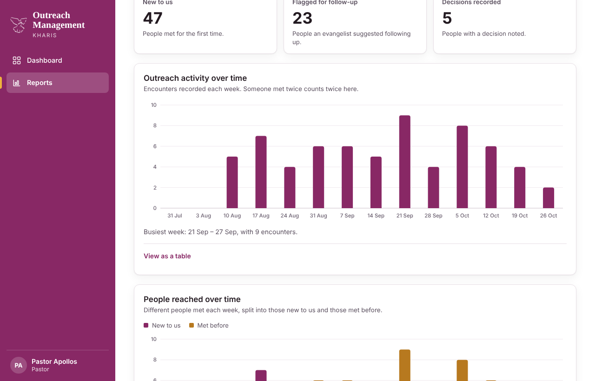
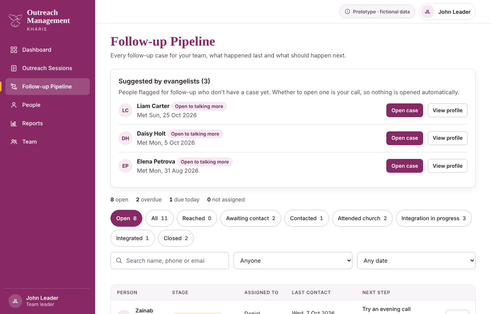
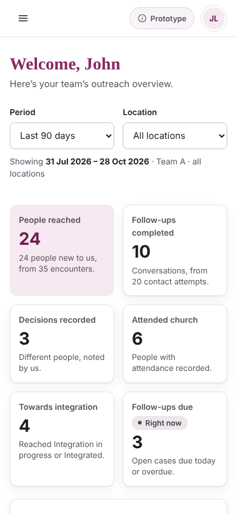
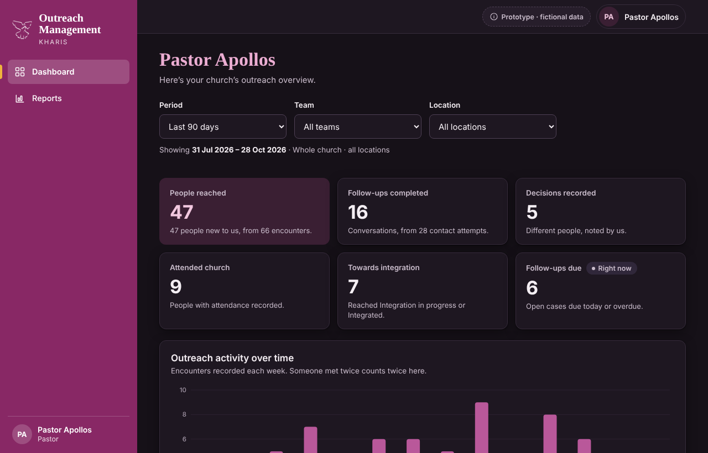

# Outreach Management

A web app for **Kharis** to record street and campus outreach, follow up with the people we meet, and give the pastor a clear, privacy-respecting picture of what is happening.

> **Status: working prototype (build stage 4 of 5).** The whole app runs in the browser on fictional data so the workflow, permissions and reports can be tested with real users before the production build. The Django version is the next stage. See [Roadmap](#roadmap).

| | |
|---|---|
|  |  |
|  |  |

<p align="center">
  
  &nbsp;&nbsp;
  
</p>

## What it does

| Role | What they can do |
|---|---|
| **Evangelist** | Record an outreach session in three short steps: who took part, who was met, what they said, and whether to suggest follow-up. |
| **Team leader** | See their own team's sessions, open follow-up cases, assign them, review possible duplicate people, correct mistakes, and read the team dashboard and reports. |
| **Coordinator** | Work the follow-up pipeline: log calls and visits, move people through the stages, set next steps. |
| **Pastor** | See church-wide dashboard and reports. **Counts only: no names, no contact details.** |
| **Administrator** | Invite and manage users and teams, set outreach areas. Sees no ministry data at all. |

Follow-up moves people through seven stages: *Reached → Awaiting contact → Contacted → Attended church → Integration in progress → Integrated*, or *Closed* with a reason. A suggestion from an evangelist is never a case until a leader decides to open one.

## Try it

1. Download [`prototype/app/outreach-management.html`](prototype/app/outreach-management.html) and open it in a browser. It is one self-contained file with no server.
2. Sign in with a demo account. Open "Prototype demo accounts" on the sign-in screen and press **Use** next to a name, or type one below. The password for all of them is `Kharis-Demo-2026`.

| Email | Role |
|---|---|
| `apollos@example.org` | Pastor |
| `john@example.org` | Team leader, Team A |
| `tunde@example.org` | Team leader, Team B |
| `sarah@example.org` | Evangelist, Team A |
| `daniel@example.org` | Coordinator, Team A |
| `michael@example.org` | Administrator |

Everyone and everything in the demo is **fictional** (phone numbers are from the reserved UK drama range, emails are `example.org`). Data is kept in your own browser's storage. "Reset demo data", in the same demo accounts panel, starts again.

## Dashboard and reports

- Period filter (7, 30, 90 days, this year, all time, custom), plus team and location filters.
- Every number has a written definition: [docs/report-definitions.md](docs/report-definitions.md). The dashboard, reports, charts and CSV exports all come from one function, so a figure can never be counted two ways.
- **People are counted once; encounters are counted every time.** "People reached" and "Encounters" are never mixed up.
- Every chart has a "View as a table" version and a plain-language summary. Charts work with the keyboard and in dark mode.
- Teams are listed by name, never ranked.
- A team leader asking for another team's figures gets the same "not found" as for a team that doesn't exist.

## About this project

I'm building this for my church, Kharis, as a learning project, in small stages that I can test and show.

- **Mine:** the idea, the requirements, the staged plan, the roles, the privacy rules (for example, the pastor sees counts only) and the decisions at each stage.
- **Built with Claude:** the code is written with Claude, an AI assistant, and checked by automated tests at every stage. Each commit carries a co-author line saying so.

## How it is built

The prototype is plain **HTML, CSS and JavaScript** in one file, with no framework. It is split into three scripts that share one global scope:

- `core`: domain rules, permissions and report calculations. No DOM. This is the part written to port straight to Django: scoped querysets become services, snapshot-and-rollback becomes `transaction.atomic()`, and the state upgrade function becomes migrations.
- `views`: functions that turn data into HTML.
- `app`: storage, events and DOM updates.

The production stack is **Python, Django, PostgreSQL, Django templates, Bootstrap and Chart.js**.

### Checks

```bash
cd prototype
python3 scripts/build.py .                                              # source -> app/outreach-management.html
node scripts/run_tests.js app/outreach-management.html scripts          # 612 logic and permission checks
node scripts/smoke_test.js app/outreach-management.html                 # 159 click-through checks
python3 scripts/contrast.py app/outreach-management.html                # colour contrast, light and dark
node scripts/export_definitions.js app/outreach-management.html ../docs/report-definitions.md
```

The tests include hand-counted report figures, an independent recount of every report on the full demo data, checks that a pastor's data and pages contain no names, phone numbers, emails or ids, and checks that every role can open every page without errors. `scripts/shoot4.py` drives a real browser (Playwright) for layout checks.

## Roadmap

| Stage | Scope | State |
|---|---|---|
| 1 | Foundation, sign-in, roles, user management | Built |
| 2 | Outreach sessions and people reached | Built |
| 3 | Follow-up pipeline, contact history, corrections, duplicate review | Built |
| 4 | Pastor dashboard and reports | Built |
| 5 | Hardening, Django build, deployment notes | Next |

## Known limitations

These are deliberate for a prototype, and each one is something the Django build must change:

- Permissions are enforced in the browser, so someone using developer tools could bypass them. The Django build enforces them on the server.
- Data lives in one browser only. There is no email, no password reset and no sign-in rate limiting yet.
- Charts are drawn as plain SVG and HTML. The Django build will use Chart.js with the same figures; every chart already has a table view.
- The pastor cannot open a person from the dashboard. Whether the pastor should be able to drill down is an open question for the church.
- Small counts can still point to an individual (one person met in a week). Nothing hides small numbers yet.
- Merging two people can't be undone, and corrections keep who changed what but not the old text. Coordinators and team leaders see all of their team's cases. These are open questions for the church.
- The definitions of the figures are drafts until Kharis leadership confirms them.
- Exports aren't logged, and there is no audit log yet.

## Repository layout

```
prototype/
  src/      the page source (one file; the logo and dark-mode colours are filled in by the build)
  app/      the built, ready-to-open prototype
  assets/   the dove logo
  scripts/  build, tests, contrast check, browser screenshots, definitions export
docs/
  report-definitions.md   how every figure is counted
  screenshots/
```
